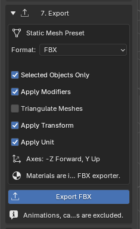
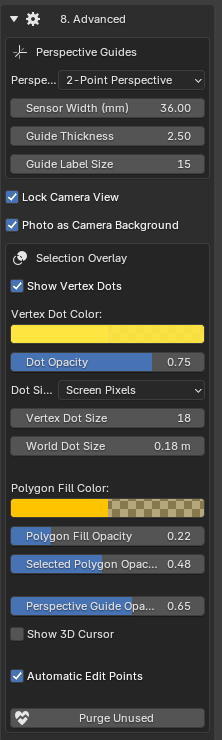
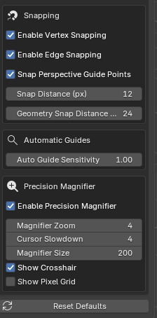

# Export e Advanced

## Export

- **Format**: sceglie FBX, OBJ o GLB; le opzioni cambiano in base al formato.
- **Selected Objects Only**: esporta solo gli oggetti selezionati.
- **Apply Modifiers**: esporta il risultato dei modificatori applicabili.
- **Triangulate Meshes**: esporta le facce triangolate quando l'opzione è disponibile.
- **Apply Transform**: controlla la trasformazione degli assi nell'export FBX.
- **Apply Unit**: applica la conversione delle unità di scena nell'export FBX.
- **Export FBX**: avvia l'esportazione nel formato selezionato; il nome del pulsante cambia con il formato.

Le righe **Axes** e le altre informazioni descrivono assi e comportamento dell'esportazione: non sono controlli modificabili.

Texture Capture Studio offre un preset per mesh statiche con **FBX** selezionato di default.

| Formato | Opzioni principali |
| --- | --- |
| FBX | Oggetti selezionati, applica modificatori, triangola, Apply Transform, Apply Unit. Usa -Z Forward e Y Up. |
| OBJ | Oggetti selezionati, applica modificatori, triangola, esporta materiali. |
| GLB | Oggetti selezionati, applica modificatori, esporta materiali. La triangolazione è gestita dall'export glTF. |

Animazioni, camere, luci e armature sono escluse da questo workflow per mesh statiche.

## Advanced

- **Perspective Mode**: sceglie la ricostruzione a due o tre punti di fuga.
- **Sensor Width (mm)**: converte la focale stimata da pixel a millimetri; non regola velocità o campo visivo risolto.
- **Guide Thickness**: imposta lo spessore visivo delle linee guida.
- **Guide Label Size**: cambia la dimensione delle etichette delle guide, come X1 e Y1.
- **Lock Camera View**: attiva la vista di lavoro sulla foto; disattivalo per navigare normalmente nella viewport.
- **Photo as Camera Background**: mostra la foto come sfondo della vista camera, conservando un riferimento interno per la cattura.
- **Show Vertex Dots**: mostra o nasconde i pallini sui vertici.
- **Vertex Dot Color**: sceglie il colore dei pallini.
- **Dot Opacity**: regola l'opacità dei pallini.
- **Dot Size Mode**: sceglie se usare pixel dello schermo o dimensione nel mondo 3D.
- **Vertex Dot Size**: regola la dimensione dei pallini in pixel nella modalità schermo.
- **World Dot Size**: regola il diametro nel mondo 3D quando è selezionata la relativa modalità; la grandezza apparente varia con la distanza.
- **Polygon Fill Color**: sceglie il colore del riempimento dei poligoni.
- **Polygon Fill Opacity**: regola l'opacità del riempimento ordinario.
- **Selected Polygon Opacity**: regola l'opacità evidenziata del poligono selezionato.
- **Perspective Guide Opacity**: regola la visibilità delle guide prospettiche colorate.
- **Show 3D Cursor**: mostra o nasconde il cursore 3D durante il lavoro sulla foto.
- **Automatic Edit Points**: permette di avvicinarsi ai punti di guide o selezioni e cliccare per modificarli direttamente.
- **Purge Unused**: pulisce i dati dell'addon non più collegati, preservando i file su disco.

- **Enable Vertex Snapping**: aggancia i punti ai vertici vicini dei poligoni.
- **Enable Edge Snapping**: aggancia un punto ai bordi vicini dei poligoni.
- **Snap Perspective Guide Points**: aggancia le estremità delle guide ai punti guida vicini.
- **Snap Distance (px)**: distanza massima, in pixel della viewport, per l'aggancio dei punti.
- **Geometry Snap Distance (px)**: distanza massima per agganciare un nuovo piano prospettico a vertici o bordi di geometrie esistenti.
- **Auto Guide Sensitivity**: aumenta o riduce la sensibilità del rilevamento automatico; valori maggiori includono anche bordi meno marcati.
- **Enable Precision Magnifier**: mostra o nasconde la lente di precisione durante il posizionamento.
- **Magnifier Zoom**: ingrandimento dell'immagine nella lente.
- **Cursor Slowdown**: rallenta il cursore per posizionamenti più precisi; 1 corrisponde alla velocità normale.
- **Magnifier Size**: dimensione della lente, in pixel.
- **Show Crosshair**: mostra il mirino sulla posizione esatta.
- **Show Pixel Grid**: mostra la griglia dei pixel sorgente nella lente.
- **Reset Defaults**: ripristina i valori predefiniti delle impostazioni gestite dall'addon.

Le impostazioni avanzate sono separate dal workflow principale per non confondere l'utente medio.

### Selection Overlay

Controlla visibilità, dimensione, colore e opacità dei punti; riempimento dei poligoni; opacità del poligono selezionato; opacità delle guide; cursore 3D. La sezione **Snapping** permette di configurare l'aggancio a vertici, bordi e guide e le relative distanze.

### Perspective Guides e Box Visibility

Qui trovi **Perspective Mode**, **Sensor Width**, spessore e dimensione delle etichette delle guide. **Automatic Guides** controlla la sensibilità del rilevamento automatico. Per i box dell'addon compatibili sono disponibili **Mask Rear Faces** e **Hide Back Faces**.

**Sensor Width** influisce sull'interpretazione in millimetri della lente stimata: non è un controllo di velocità o di sensibilità del mouse.

### Precision Magnifier

Lo zoom di precisione aiuta a posizionare correttamente i punti di estrazione:

- attivazione dello zoom;
- quantità di ingrandimento e dimensione della finestra;
- mirino centrale;
- griglia dei pixel agli ingrandimenti elevati.

Lo zoom aiuta durante il posizionamento e la modifica; puoi regolare anche il rallentamento del cursore con **Cursor Slowdown**.

### Reset e pulizia

- **Reset Defaults** ripristina le impostazioni predefinite dell'addon.
- **Purge Unused** elimina i data-block inutilizzati generati da Texture Capture Studio, preservando le texture presenti nella lista e i file salvati.
