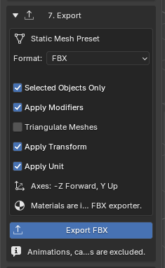

# Consigli export

- **Format**: sceglie FBX, OBJ o GLB; le opzioni cambiano in base al formato.
- **Selected Objects Only**: esporta solo gli oggetti selezionati.
- **Apply Modifiers**: esporta il risultato dei modificatori applicabili.
- **Triangulate Meshes**: esporta le facce triangolate quando l'opzione è disponibile.
- **Apply Transform**: controlla la trasformazione degli assi nell'export FBX.
- **Apply Unit**: applica la conversione delle unità di scena nell'export FBX.
- **Export FBX**: avvia l'esportazione nel formato selezionato; il nome del pulsante cambia con il formato.

Le righe **Axes** e le altre informazioni descrivono assi e comportamento dell'esportazione: non sono controlli modificabili.

Texture Capture Studio offre un preset per mesh statiche con **FBX** selezionato di default.

| Formato | Opzioni principali |
| --- | --- |
| FBX | Oggetti selezionati, applica modificatori, triangola, Apply Transform, Apply Unit. Usa -Z Forward e Y Up. |
| OBJ | Oggetti selezionati, applica modificatori, triangola, esporta materiali. |
| GLB | Oggetti selezionati, applica modificatori, esporta materiali. La triangolazione è gestita dall'export glTF. |

Animazioni, camere, luci e armature sono escluse da questo workflow per mesh statiche.

## Prima di esportare

- Controlla materiali e UV delle mesh selezionate.
- Salva il progetto e verifica la cartella di destinazione.
- Per FBX controlla assi, scala e unità nel programma di arrivo.
- Dopo l'esportazione riapri il file nel software di destinazione per verificare geometria e materiali.
