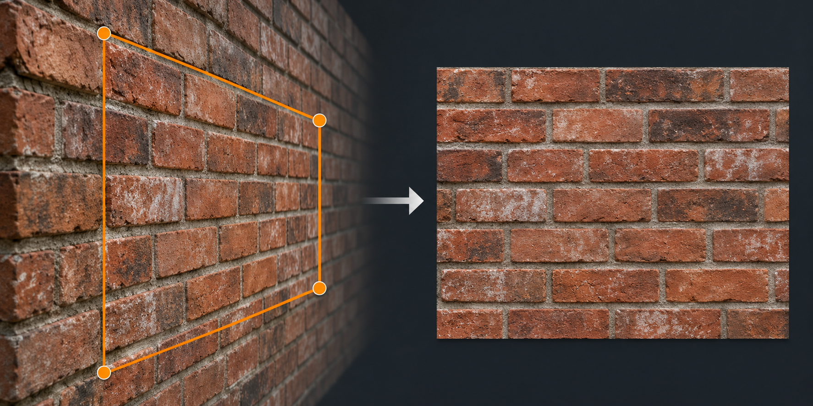
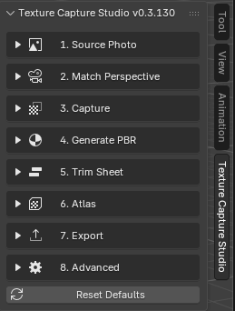

# Texture Capture Studio

Bozza documentazione

Estrai texture ad alta risoluzione direttamente dalle fotografie, correggi la prospettiva, genera mappe PBR e crea Trim Sheet o Atlas allineati in Blender.

Foto sorgente → Match Perspective → Estrazione → PBR → Trim / Atlas → Export

*Illustrazione concettuale generata con IA: mostra l'obiettivo della cattura, non un risultato misurato o una schermata di Blender.*

## Il pannello dell'addon

Nella viewport 3D premi **N** e apri **Texture Capture Studio**. Le sezioni seguono le fasi del lavoro: puoi aprire solo quelle che ti servono. Clicca sulle immagini di questa guida per ingrandirle.

- **1. Source Photo**: carica o rimuove la fotografia sorgente.
- **2. Match Perspective**: imposta le guide e ricostruisce la prospettiva per creare geometria allineata.
- **3. Capture**: seleziona aree della foto, estrae texture e gestisce i poligoni.
- **4. Generate PBR**: genera mappe derivate e configura il displacement.
- **5. Trim Sheet**: compone le texture in fasce, anche ripetibili orizzontalmente.
- **6. Atlas**: organizza più regioni in una texture condivisa.
- **7. Export**: esporta la geometria nei formati disponibili.
- **8. Advanced**: raccoglie le impostazioni di guide, visualizzazione, snapping e lente di precisione.
- **Reset Defaults**: ripristina i valori predefiniti delle impostazioni gestite dall'addon.

La freccia a sinistra di ogni titolo apre o chiude la sezione.

<small>Interfaccia della versione 0.3.130.</small>

## Cosa fa Texture Capture Studio

Texture Capture Studio utilizza i pixel reali dell'immagine sorgente caricata. **Non** cattura la viewport di Blender, quindi la qualità non dipende dalla risoluzione del monitor.

Se un muro occupa 2200 × 1600 pixel in una foto da 8000 × 6000, la texture estratta può conservare circa quel dettaglio anche se la viewport è visualizzata su un monitor 1080p.

## Funzioni principali

- Ricostruzione opzionale della prospettiva a due o tre punti per foto architettoniche.
- Estrazione con quattro punti tramite correzione prospettica, proiezione tessellata o proiezione dalla camera.
- Creazione di box e piani prospettici e trasferimento della foto alle facce compatibili, anche di un cubo Blender.
- Gestione di più poligoni e texture estratte.
- Generazione PBR: Normal, Height, Roughness e Ambient Occlusion.
- Displacement dalla Height map con configurazione automatica di suddivisione e modificatore Displace.
- Trim Sheet con fasce orizzontali U 0–1, seamless e anteprima della ripetizione; è disponibile anche la composizione precedente.
- Anteprima e creazione di texture seamless, con controlli per maschera e sfumatura.
- Packing automatico pixel-perfect dell'Atlas conservando la densità dei pixel originale.
- Export di mesh statiche in FBX, OBJ o GLB.
- Zoom di precisione, snapping, overlay e altri controlli avanzati di disegno.

!!! note "Le mappe PBR sono stime"
    Le mappe generate da una singola foto a colori sono un'ottima base di lavoro, ma non sono dati fisici misurati. Luci, ombre e riflessi presenti nella fotografia possono influenzare il risultato.

## Compatibilità

Texture Capture Studio richiede **Blender 4.2 o successivo** e si installa come Blender Extension in formato ZIP.

## Inizia da qui

- [Installazione](installation.md)
- [Guida rapida](quick-start.md)
- [Workflow completo](workflow.md)
- [Mappe PBR e displacement](pbr-maps.md)
- [Trim Sheet e Atlas](trim-atlas.md)
- [Domande frequenti](faq.md)
- [Risoluzione problemi](troubleshooting.md)
- [Contatta il supporto](support.md)
- [Video tutorial](video-tutorials.md)
