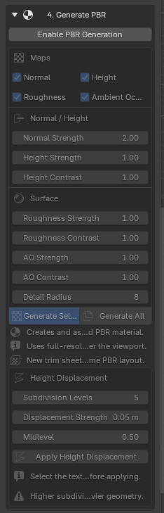

# Mappe PBR e displacement

Texture Capture Studio può ricavare quattro mappe di supporto dalla texture Base Color estratta.

Apri **4. Generate PBR**, premi **Enable PBR Generation** e scegli le mappe da generare. I gruppi **Normal / Height** e **Surface** regolano il risultato; in basso trovi anche i controlli per il displacement. Nella schermata i controlli sono disattivati perché la generazione non è ancora stata abilitata.

## Mappe disponibili

| Mappa | Funzione |
| --- | --- |
| Normal | Simula piccole variazioni di direzione della superficie senza aggiungere geometria. |
| Height | Memorizza l'altezza relativa della superficie in scala di grigi. |
| Roughness | Controlla quanto i riflessi appaiono larghi oppure nitidi. |
| Ambient Occlusion | Stima l'oscuramento nelle piccole cavità e nei dettagli di contatto. |

## Controlli

- **Normal Strength** controlla l'intensità dei gradienti della Normal map.
- **Height Strength** e **Height Contrast** regolano l'intervallo della mappa in scala di grigi.
- **Roughness Strength** e **Roughness Contrast** regolano le variazioni di riflessione.
- **AO Strength** e **AO Contrast** controllano l'oscuramento delle cavità.
- **Detail Radius** cambia la scala del dettaglio locale analizzato.

Usa **Generate Selected** per la texture estratta attiva oppure **Generate All** per tutte le texture estratte.

## Height displacement

La Height map generata può deformare realmente la geometria:

1. Crea e assegna il materiale a una mesh.
2. Seleziona la mesh.
3. Imposta **Subdivision Levels**.
4. Imposta **Displacement Strength** in unità Blender.
5. Imposta **Midlevel**; con 0.5 il grigio medio non produce spostamento.
6. Premi **Apply Height Displacement**.

Su un muro di mattoni, mattoni e fughe possono acquistare una profondità visibile. La qualità dipende dalla densità della mesh e da quanto la foto permette di distinguere il rilievo reale dall'illuminazione.

!!! note
    Da una sola fotografia non è sempre possibile distinguere geometria, colore dipinto, ombre e riflessi. Regola i valori prima di applicare una suddivisione pesante.

## Coerenza di Trim e Atlas

Quando le mappe PBR esistono, i nuovi Trim Sheet e Atlas riutilizzano lo stesso layout per Base Color, Normal, Height, Roughness e AO. Tutte le mappe restano così allineate alle stesse coordinate UV.
