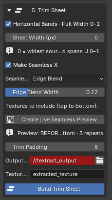
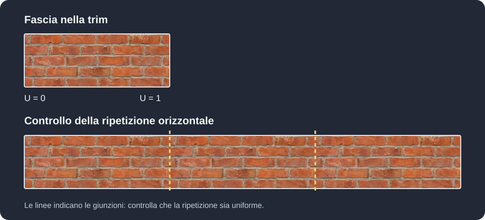
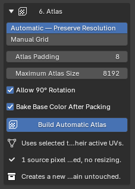

# Trim Sheet e Atlas

## Trim Sheet

La sezione **5. Trim Sheet** combina le texture estratte in un'unica immagine. Dalla versione 0.3.127 puoi creare fasce orizzontali che occupano l'intera larghezza UV, utili per materiali come cornici, mattoni e rivestimenti.

- **Horizontal Bands · Full Width 0–1**: attiva le fasce orizzontali estese su tutta la larghezza UV.
- **Sheet Width (px)**: larghezza finale; con 0 usa la larghezza della sorgente più ampia.
- **Make Seamless X**: sfuma le giunzioni sinistra/destra delle fasce senza modificare gli originali.
- **Seamless Method**: sceglie **Edge Blend** o **Mirror & Blend**.
- **Edge Blend Width**: controlla quanto è ampia l'area di sfumatura.
- **Textures to include**: consente di scegliere le texture estratte da includere; nello screenshot la lista è vuota.
- **Create Live Seamless Preview**: confronta prima e dopo con tre ripetizioni orizzontali.
- **Live Preview**, dopo la creazione dell'anteprima: abilita l'aggiornamento delle modifiche.
- **Trim Padding**: imposta il margine in pixel tra le fasce.
- **Output Folder** e pulsante cartella: scelgono la destinazione del risultato.
- **Texture Name**: imposta il nome base della trim.
- **Build Trim Sheet**: crea e salva la composizione definitiva.

Le righe con l'icona informativa descrivono i valori e l'anteprima: non sono pulsanti.

*Schema illustrativo: la fascia attraversa tutto il quadrato UV da U = 0 a U = 1. Sotto, lo spazio UV è ripetuto tre volte; le linee tratteggiate mostrano dove controllare le giunzioni. La griglia è solo un riferimento visivo.*

### Creare fasce orizzontali

1. Estrai dalla foto le texture che vuoi utilizzare.
2. Apri **5. Trim Sheet** e lascia attiva **Horizontal Bands · Full Width 0–1**.
3. In **Textures to include** seleziona le texture da includere. Le fasce seguono l'ordine mostrato nella lista, dall'alto verso il basso.
4. Imposta **Sheet Width (px)**: con `0` viene usata la larghezza della texture sorgente più larga; altrimenti puoi scegliere una larghezza fino a 8192 pixel.
5. Regola **Trim Padding**, scegli **Output Folder** e **Texture Name**, quindi premi **Build Trim Sheet** per creare il risultato.

Ogni fascia va dal bordo sinistro al bordo destro della texture, cioè da **U = 0 a U = 1**; le fasce sono impilate lungo V. Il contenuto può essere ripetuto un numero intero di volte e ridimensionato proporzionalmente per adattarsi alla larghezza scelta: non è quindi garantito che mantenga esattamente la dimensione originale in pixel. Il padding riempie i margini tra le fasce con i colori dei bordi, evitando spazi trasparenti.

### Rendere continua la ripetizione

Attiva **Make Seamless X** per sfumare la giunzione tra il bordo sinistro e quello destro di ogni fascia. Le texture estratte originali non vengono modificate.

- **Edge Blend** sfuma insieme i due bordi ed è il metodo predefinito.
- **Mirror & Blend** copia specchiata una parte del bordo sinistro verso destra e la sfuma con una maschera.
- **Edge Blend Width** controlla l'ampiezza della zona di sfumatura. Un valore maggiore può nascondere meglio la giunzione, ma modifica un'area più ampia della texture.

Premi **Create Live Seamless Preview** per confrontare le fasce ripetute tre volte: **prima** in alto e **dopo** in basso. Dopo aver creato l'anteprima, il controllo **Live Preview** permette di aggiornare il confronto quando cambi le impostazioni. Controlla visivamente la giunzione: a seconda della foto possono restare ripetizioni evidenti, ombre o discontinuità.

<strong>Immagine da aggiungere: anteprima seamless</strong>Schermata reale con le tre ripetizioni prima e dopo la sfumatura, evidenziando le giunzioni.

L'anteprima serve per la verifica: premi comunque **Build Trim Sheet** per generare la trim definitiva nella cartella di output. Se esistono le corrispondenti mappe PBR, i risultati usano lo stesso layout della Base Color.

!!! note
    La modalità seamless della Trim Sheet riguarda la ripetizione **orizzontale**. Per il controllo seamless di una singola texture è disponibile anche la sezione **Make Seamless** nelle texture estratte.

### Composizione precedente

Disattiva **Horizontal Bands · Full Width 0–1** per usare la composizione precedente. In questa modalità **Vertical Trim Sheet** cambia l'orientamento della composizione e **Trim Padding** imposta lo spazio tra le regioni.

## Modalità Atlas

- **Automatic — Preserve Resolution**: organizza le isole delle mesh selezionate senza ridimensionare le regioni sorgenti.
- **Manual Grid**: passa alla composizione tramite celle e colonne fisse.
- **Atlas Padding**: imposta lo spazio attorno alle regioni impacchettate.
- **Maximum Atlas Size**: limite della dimensione dell'atlas automatico; le regioni non vengono ridotte per farle entrare.
- **Allow 90° Rotation**: permette di ruotare le isole complete per migliorare il packing.
- **Bake Base Color After Packing**: esegue il bake della Base Color sull'atlas dopo il packing.
- **Build Automatic Atlas**: crea l'atlas automatico a partire dalle mesh selezionate e dalle loro UV attive.

I messaggi in basso descrivono i requisiti e indicano che viene creata una nuova copia, lasciando gli originali intatti.

### Automatic — Preserve Resolution

La modalità automatica usa le mesh texturizzate selezionate e le loro UV attive. Misura ogni isola UV con la relativa immagine sorgente e ricrea il packing senza modificare l'ingombro in pixel.

Per esempio, se una regione della mesh usa esattamente 200 × 300 pixel sorgente, nell'Atlas la regione rimane di 200 × 300 pixel. Cambia la posizione UV, ma il dettaglio della texture non diventa più grande o più piccolo.

Opzioni:

- **Maximum Atlas Size**: dimensione massima consentita per l'Atlas.
- **Allow 90° Rotation**: ruota le isole complete quando migliora il packing.
- **Bake Base Color After Packing**: esegue il bake dei materiali copiati nella nuova texture condivisa.
- **Atlas Padding**: spazio intorno alle regioni impacchettate.

L'operazione crea una collection dedicata **Texture Capture Studio - Atlas**. Mesh e materiali sono copie indipendenti; gli oggetti originali mantengono UV, materiali e texture.

<strong>Immagine da aggiungere: atlas automatico</strong>Mesh selezionate prima del packing e atlas risultante con le isole UV organizzate.

!!! important
    Il packing automatico conserva la densità dei pixel. Se le regioni non entrano nella dimensione massima senza ridimensionamento, occorre usare un Atlas più grande oppure meno regioni sorgente.

### Manual Grid

La modalità manuale usa celle di dimensione fissa e un numero prestabilito di colonne. È utile per slot volutamente uniformi, ma non calcola l'ingombro in pixel di ogni isola UV come la modalità automatica.

## Output Atlas PBR

Quando le mappe corrispondenti esistono, Texture Capture Studio può produrre output allineati come:

- `atlas_basecolor`
- `atlas_normal`
- `atlas_height`
- `atlas_roughness`
- `atlas_ao`

Tutte le mappe condividono lo stesso layout delle isole e le stesse coordinate UV.
