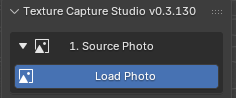
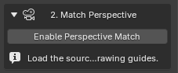
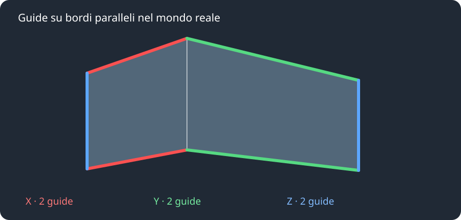
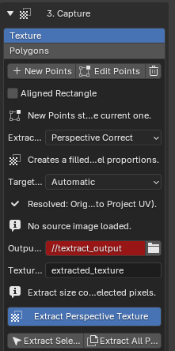
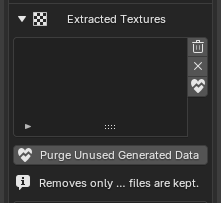
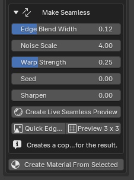

# Workflow completo

Questa guida descrive il workflow di Texture Capture Studio; le schermate dell'interfaccia sono della versione 0.3.130. Match Perspective e le fasi PBR sono opzionali: per estrarre una porzione di foto puoi passare direttamente da **Source Photo** a **Capture**.

## 1. Source Photo

**Load Photo** apre la scelta dell'immagine sorgente. Una volta caricata, la foto diventa il riferimento per la cattura e per l'eventuale ricostruzione prospettica.

Premi **Load Photo** e scegli la fotografia. Per rimuoverla usa il cestino accanto al nome. **Lock Camera View**, in Advanced, mantiene la vista dedicata al lavoro sulla foto; disattivalo quando vuoi navigare liberamente nella scena.

La cattura usa l'immagine originale, non la risoluzione dello schermo. La dimensione dell'output dipende dalla porzione selezionata e dal metodo di estrazione: la correzione prospettica può interpolare i pixel e non può ricostruire dettagli assenti nella foto.

## 2. Match Perspective

**Enable Perspective Match** attiva i controlli per disegnare le guide. Carica prima una fotografia: la schermata a destra mostra lo stato iniziale, quando non è ancora stata scelta.

Usa questa fase se vuoi ricostruire la prospettiva della foto per modellare geometrie allineate o stimare le proporzioni di una superficie. Non è necessaria per una semplice cattura 2D.

*Schema illustrativo: le guide dello stesso colore seguono bordi paralleli nel mondo reale, non necessariamente paralleli nella foto.*

1. Attiva **Enable Perspective Match**.
2. Premi **Draw X Guides** e disegna due linee sui bordi della prima direzione, evidenziata in rosso.
3. Con **Draw Y Guides** disegna due linee sui bordi della seconda direzione orizzontale, in verde.
4. Disegna due guide verticali con **Draw Z Guides**. In modalità 2-Point il calcolo può partire anche senza Z; in 3-Point sono richieste.
5. Premi **Solve Camera**. Se le guide non corrispondono bene ai bordi, usa **Edit Guides**, correggile e ripeti il calcolo.

**Auto Detect Guides** propone un posizionamento automatico: verifica sempre le linee sulla foto e correggile prima del solve. Per ripartire usa **Clear All Guides**.

In **Advanced → Perspective Mode**, **2-Point Perspective** è il valore predefinito ed è adatto a foto con verticali approssimativamente parallele. **3-Point Perspective** considera anche la convergenza verticale: usa due linee per ciascuno degli assi X, Y e Z. Tre punti di fuga non significano tre linee per asse.

### Perspective Geometry

Dopo il solve puoi usare **Create Box** oppure creare un piano con **Auto Plane**, **Ground**, **Front** o **Side**. Durante la creazione si impostano le dimensioni progressivamente; **Extrude** aggiunge un passaggio per la profondità e **Snapping** abilita l'aggancio. Con un oggetto dell'addon selezionato puoi regolare **Wireframe**, **Wire Opacity** e **Base Opacity**. In Advanced sono disponibili anche i controlli di visibilità delle facce posteriori per i box compatibili.

La precisione della ricostruzione dipende dalla qualità delle guide e dalle ipotesi geometriche: controlla l'allineamento sulla foto e non considerare le dimensioni fisiche assolute automaticamente misurate.

## 3. Capture → Texture

Nella modalità **Texture**, **New Points** avvia la selezione e **Edit Points** permette di correggerla. Più in basso scegli metodo, proporzioni, cartella e nome, poi premi **Extract Perspective Texture**. La schermata mostra il pannello prima di caricare una foto: alcuni messaggi sono abbreviati per la larghezza della sidebar.

Premi **New Points** e indica quattro angoli consecutivi dell'area. Usa **Edit Points** per correggerli; nella modalità **Polygons** puoi gestire le aree già create. **Aligned Rectangle** permette invece di definire un rettangolo con due angoli.

### Extraction Method

| Metodo | Risultato |
| --- | --- |
| **Perspective Correct** | Raddrizza un quadrilatero in una texture rettangolare; è il punto di partenza per pareti, pavimenti e altre superfici piane. |
| **Projection Paint — Tessellated** | Trasferisce la proiezione della foto su UV rettangolari tramite una griglia triangolata; **Projection Grid** ne regola la suddivisione. |
| **Camera Projected** | Conserva la proiezione vista dalla camera: non produce necessariamente un rettangolo riempito e raddrizzato. |

Il tipo di contenuto — per esempio acqua o pavimentazione — non garantisce da solo un metodo migliore. La geometria, la prospettiva e i punti scelti influenzano il risultato: confronta le anteprime.

### Target UV Ratio

- **Automatic** sceglie una stima dalle informazioni disponibili e usa la superficie 3D risolta quando disponibile.
- **Selected Pixels** usa l'ampiezza e l'altezza della selezione nella foto.
- **Solved 3D Surface** usa le proporzioni della superficie ricostruita e richiede Match Perspective risolto.
- **Custom Ratio** permette di inserire larghezza divisa per altezza, utile quando conosci le proporzioni reali.

Senza informazioni aggiuntive, un rettangolo visto in prospettiva non rivela necessariamente le sue proporzioni reali. **New Points Surface**, mostrato con Perspective Match attivo, permette di scegliere la foto 2D o una superficie 3D; per le superfici 3D occorre prima risolvere la prospettiva.

Scegli **Output Folder** e **Texture Name**, poi premi **Extract Perspective Texture**. Per più aree puoi usare **Extract Selected Polygon** o **Extract All Polygons**.

## 3. Capture → Polygons: trasferire la foto a un box

La sezione **Polygons** gestisce i poligoni e il trasferimento sulle facce di geometrie compatibili: box o piani creati dall'addon e cubi standard di Blender.

1. Carica la foto, allinea la geometria alla vista e seleziona il box, il piano compatibile o il cubo.
2. Scegli **Capture → Polygons** e controlla **Opposite Face UV**: **None** non riusa la faccia opposta; **Stacked** riusa le UV; **Stacked Mirrored** le specchia.
3. In **Object Mode**, premi **Extract & Map Visible Faces** per elaborare le facce viste dalla camera. In **Edit Mode**, seleziona esattamente una faccia quadrangolare e premi **Extract & Map Selected Face**.

Per un cubo Blender standard l'addon applica la scala e crea una mappa UV **Photo Transfer** per la proiezione. Verifica il risultato e le facce opposte: la foto contiene solo le informazioni effettivamente visibili, quindi non può ricostruire automaticamente il retro nascosto.

## Extracted Textures e Make Seamless

La lista raccoglie le texture estratte; i pulsanti laterali aiutano a eliminare o gestire i risultati. **Purge Unused Generated Data** pulisce i dati generati non più utilizzati, senza eliminare i file salvati su disco.

In **Make Seamless** regoli la sfumatura, il rumore e la deformazione. Avvia l'anteprima, controlla la ripetizione e, quando il risultato ti convince, esegui il bake. **Preview 3 x 3** aiuta a individuare le giunzioni.

In **Extracted Textures** puoi selezionare e visualizzare i risultati, eliminarli, pulire i dati generati inutilizzati e creare un materiale. Per una singola texture, apri **Make Seamless**:

1. Seleziona la texture e regola **Edge Blend Width**, **Noise Scale**, **Warp Strength**, **Seed** e, se necessario, **Sharpen**.
2. Premi **Create Live Seamless Preview** per verificare il risultato. Dopo la creazione puoi aprire **Edit Mask in Image Editor** per intervenire sulla maschera.
3. Premi **Bake Seamless Texture** per creare il risultato. In alternativa usa **Quick Edge Blend** per una sfumatura rapida e **Preview 3 x 3** per controllare la ripetizione.

Questi controlli lavorano su una singola texture; le opzioni per le fasce orizzontali sono nella pagina [Trim Sheet e Atlas](trim-atlas.md).

## Passaggi successivi

- [Mappe PBR e displacement](pbr-maps.md)
- [Trim Sheet e Atlas](trim-atlas.md)
- [Export e Advanced](export-advanced.md)
